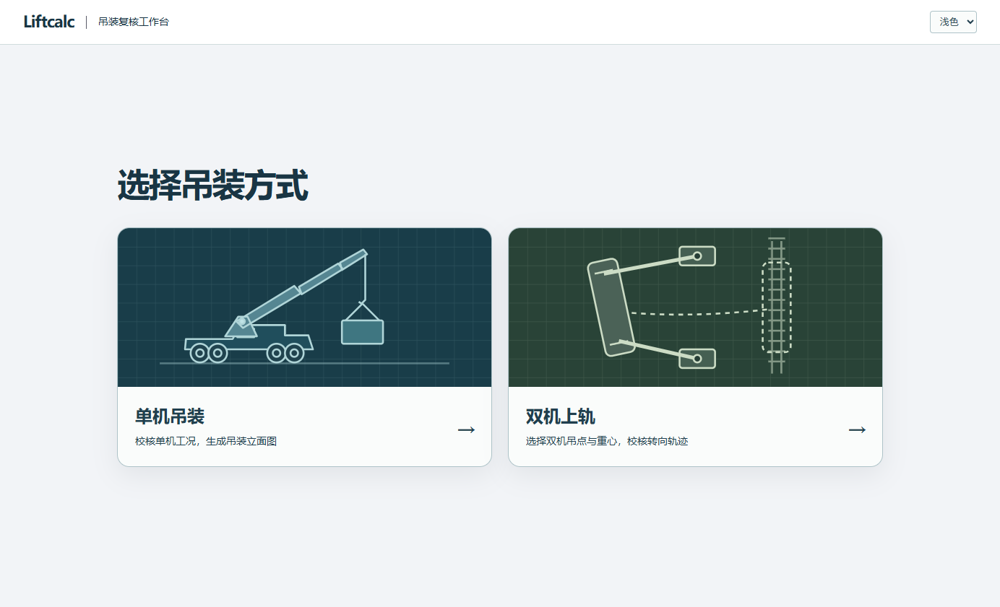
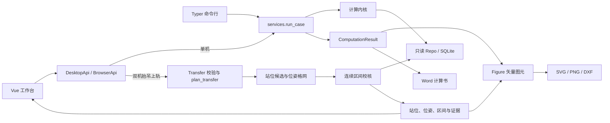

# liftcalc · 单机吊装校核与双机抬吊上轨

liftcalc 是在 Windows 本地运行的吊装计算工作台。单机模式按原厂起重性能表校核起重量、工作幅度和有资料支持的起升高度。双机模式按选定吊点与重心计算分载，搜索两台起重机的固定站位和吊物的水平转运轨迹，并标明超限或待核区间。

[启动工作台](#启动工作台) · [单机吊装](#单机吊装) · [双机抬吊上轨](#双机抬吊上轨) · [算例验证](#算例验证) · [机型与数据](#机型与数据) · [代码架构](#代码架构) · [命令行](#命令行) · [开发与复验](#开发与复验)



## 启动工作台

在装有 **Python 3.12 或更高版本**的 Windows 电脑上，下载并解压完整仓库。在仓库根目录打开 PowerShell，首次使用执行以下命令，安装项目及桌面依赖。

```powershell
python -m venv .venv
.\.venv\Scripts\python.exe -m pip install -e ".[desktop]"
.\启动单机工作台.cmd
```

以后双击 `启动单机工作台.cmd` 即可进入首页，选择单机或双机。首次安装依赖需要联网；之后界面、车型数据和 DXF 查看器均可离线使用。桌面端每次从随仓库提供的数据包建立临时数据库。

窗口默认最大化，右上角可切换浅色或深色。默认使用 pywebview 和 WebView2；原生宿主启动失败时，程序会尝试 Edge 或 Chrome 独立窗口。启动异常可查看 `%TEMP%\liftcalc-error.log`。

## 单机吊装

1. **吊物与重心**　输入吊物质量、长宽高、重心坐标和吊点内缩。轴测图显示四个吊点，吊钩的水平位置与重心投影一致。
2. **机型与工况**　从按标称最大起重量排序的机型列表选车，再选择起重性能表工况及实际安装的主吊钩组。界面同时给出当前选表范围内的最大表列额定总起重量。
3. **计算与出图**　可指定工作幅度，也可反查满足条件的最大表列工作幅度。结果显示采用的额定总起重量、负荷率、所需吊钩中心离地高度和表列起升高度。

所需吊钩中心离地高度为吊物底面离地高度、吊物高度与吊物顶面至吊钩中心的竖向距离之和。输入时也可切换到从吊物底面量取，或按四吊点几何估算顶面至吊钩中心的距离。

单机计算总起重量为 **吊物质量 + 吊钩组质量 + 吊索具质量 × 索具动载系数**。指定工作幅度介于两列之间时，按同一工况和臂长内较大的表列幅度校核负荷率。若需要校核指定工作幅度下的起升高度，缺少对应资料时会提示资料不足。四索受力结果以 kN 显示名义拉力及各索静力平衡范围，各索的上限可对应不同的平衡状态。

单机支持导出 DXF、SVG、PNG 和 Word 计算书。图纸可放大、拖动和平移，CAD 查看器可以只读打开本次 DXF 或 32 MB 以内的本地 DXF。[CAD 查看器截图](docs/handover/assets/refract-cad.png)

## 双机抬吊上轨

| 步骤 | 操作与结果 |
|---|---|
| 1 · 吊物、吊点与重心 | 在吊物的局部坐标系内选择吊点 A、B 和重心 G。修改吊点、重心或质量时，界面即时显示两台起重机各自承担的质量和比例。 |
| 2–3 · A 机和 B 机工况 | 为两机分别选择机型、起重性能表工况和固定臂长。机型标注标称最大起重量，选定工况和臂长后显示相应的最大表列值。填写吊钩组和吊索具参数，以及含展开支腿的占地包络。 |
| 4 · 转运与场地 | 填写起吊与轨道落位姿态、圆形障碍物、水平净距要求及轨距。可以自动搜索两机站位，也可以锁定实测站位再搜索轨迹。图纸的离地高度和两侧吊钩竖向距离为选填示意尺寸。 |
| 5 · 图纸与校核 | 查看每台机的分载、工作幅度上界、负荷率和最小水平净距下界。不通过与待核项按轨迹区间显示，点击问题可定位回放。搜索未生成可用轨迹时，页面列出记录到的阻碍。 |

**分载**按水平刚体和两根竖向吊索求静力平衡。若 G 的水平投影 P 在 A、B 连线上且严格位于两点之间，则 A 侧分担比例为 PB / AB，B 侧为 AP / AB。起吊后两机固定，计算使用用户选定的两个吊点和重心。

每台机的计算总起重量为 **（本机分担的吊物质量 + 本侧吊索具质量）× 载荷放大系数 + 本机吊钩组质量**。双机校核范围为承载、工作幅度和水平位置，包括占地、障碍与起重臂水平投影包络的净距。起升高度及起升、下放过程需另行校核。默认负荷率上限为单机 90% 和双机每台 80%，是软件采用的项目判定参数。

**图纸**包括同一比例的第一角法静力三视图、带轨道和站位的转运轨迹平面图，以及 A、B 两机各自的 P0 起吊端视图。静力图按长、高、宽对齐并保留吊点与分载标注。两张端视图沿用单机的车身、主臂、起升钢丝绳和吊索画法。图纸支持放大及导出 DXF。

[12 m 列车演示](cases/rail-transfer-demo.json) · [自动避障站位](cases/rail-transfer-auto-stagger.json) · [斜穿两机间隙](cases/rail-transfer-oblique.json) · [固定站位、净距至少 1 m](cases/rail-transfer-1m-clearance.json)

## 算例验证

| 验证对象 | 输入与可复算的结果 |
|---|---|
| 单机跨幅度档 | 三一 STC1100T7，38.5 t 全配重，侧后方作业，总吊重 34 t。10.00 m 时可选 36.7 m 臂、额载 39 t，负荷率 **87.18%**。10.01 m 向外取 12 m 档，适用臂长中最大额载降至 32.3 t，触发超限。 |
| 双机转向中段超载 | 构造两机对称吊 50 t 的转向路径，B 机总吊重 28.565 t、臂长 36.7 m。起止幅度均为 9.883 m，负荷率 **73.24%**；中途幅度增至 10.100 m，负荷率升至 **89.27%**，工作台检出中段超过 80% 限值。 |
| 偏心四吊点 | ITI 图 3 给出总重 8,000 lbf、吊点纵距 10 ft、重心距 A/B 端 3 ft。复算的竖向反力范围为 A、B 各 **1,600–4,000 lbf**，C、D 各 **0–2,400 lbf**，与原题逐点一致。 |

武汉体育中心钢桁架的双机设计负荷率复算为 **85.798%**，论文为 85.8%。另有盾构双机翻身设计荷载、四组工业模块起落点回转角，以及机身从两台汽车吊之间穿过的现场分载对照。[论文与现场工程复算](cases/README.md#论文与现场工程复算)

算例文档列出原厂表页、教材答案、解析几何题、误差和适用条件。双机中段超载例使用厂家额载与自设站位，检验的是转动中的跨档判定。[算例与原始资料](cases/README.md) · [可执行回归用例](tests/test_reference_lifts.py)

## 机型与数据

桌面工作台使用随仓库提供的 CSV 数据包，共收录 **27 款机型、730 组配置、11,285 个额载格点**。机型涵盖徐工、三一、中联的汽车起重机，以及徐工 QAY200/QAY300 全地面起重机，标称吨位为 25–300 t。查表按实车配重、支腿状态、伸缩组合、允许作业方位及所装主吊钩组选取工况。

CLI 默认读取随仓库提交的 SQLite 快照。要在 CLI 使用桌面端的完整机型数据，可按[开发与复验](#开发与复验)中的命令重建数据库，或用 `--db` 指向另建的数据库。

<details>
<summary>展开车型清单、格点数及原厂表页</summary>

| 机型 | 吨位 | 类型 | 配置 | 格点 |
|---|---|---|---|---|
| QY70K-1 | 70 t | 汽车吊 | 7 | 77 |
| QY100H-3 | 100 t | 汽车吊 | 9 | 152 |
| QY130H-1 | 130 t | 汽车吊 | 18（配重 30/20 t 两套） | 273 |
| QAY200 | 200 t | 全地面 | 12 | 214 |
| XCT25L5_Y | 25 t | 汽车吊 | 15（固定全配重 5.8 t） | 192 |
| XCT60_Y | 60 t | 汽车吊 | 15（固定 5.5 t + 活动 1 t） | 204 |
| XCT100_1 | 100 t | 汽车吊 | 29（全配重 45 t，按伸缩码分列） | 432 |
| 三一 STC500 | 50 t | 汽车吊 | 11（固定全配重 3.5 t） | 183 |
| 三一 STC550C5 | 55 t | 汽车吊 | 15（固定 5.2 t + 活动 2.3 t） | 216 |
| 三一 STC750 | 75 t | 汽车吊 | 9（固定 4.5 t + 活动 2 t） | 154 |
| 三一 STC1100T7 | 110 t | 汽车吊 | 14（全配重 38.5 t，侧后方） | 242 |
| 三一 STC1200T7 | 120 t | 汽车吊 | 14（巴西缓速器版，全配重 36.2 t） | 234 |
| 三一 STC1600T7 | 160 t | 汽车吊 | 28（全配重 52 t，常规位和全后移各 14 组） | 463 |
| 三一 STC2000C8-8 | 200 t | 汽车吊 | 14（2024 款，全配重 61 t） | 281 |
| 三一 STC2400C8PHEV | 240 t | 汽车吊 | 18（全配重 71 t，后移 R 位） | 394 |
| 三一 STC3000C8-8 | 300 t | 汽车吊 | 17（全配重 73.5 t，普通主臂） | 352 |
| 徐工 XCT130L8_1 | 130 t | 汽车吊 | 161（65.3–85 m 伸缩组合） | 2273 |
| 徐工 QAY300 | 300 t | 全地面 | 138 | 2084 |
| 三一 STC1300C8-8 | 130 t | 汽车吊 | 36 | 619 |
| 中联 ZTC250A | 25 t | 汽车吊 | 36 | 549 |
| 三一 STC1000C7-8 | 100 t | 汽车吊 | 28（25 款） | 458 |
| 三一 STC800C5-8 | 80 t | 汽车吊 | 21（配重 16/18/20 t） | 312 |
| 三一 STC500C5-8 | 50 t | 汽车吊 | 21（25 款 + 系列 Val/Pro 两版合并） | 257 |
| 三一 STC1300C7-8 | 130 t | 汽车吊 | 14 | 260 |
| 三一 STC250C5-8 | 25 t | 汽车吊 | 11（25 款） | 163 |
| 三一 STC400T5-6 | 40 t | 汽车吊 | 11 | 144 |
| 三一 STC350C5-1 | 35 t | 汽车吊 | 8 | 103 |
| **合计** | | | **730** | **11285** |

新增 11 款来自厂商公开规格书（PDF 存于 `../lift/原始PDF/`），每格带原表页码。
STC500C5-8 的“25 款”与“系列 Val/Pro”两份表 config 不重叠，已合并为同一机型。
XCT130L8_1、STC800C5-8、STC500C5-8 共 11 处小幅度段额定值回增，
经逐条核对为原厂表真实值，CSV 的 note 已标注并在校验中按警告处理。

全部 27 款已录入规格书元数据：自重、支腿纵横跨距、主/副钩自重（多钩机型见
`main_hooks.csv`），XCT130L8_1 另有原厂最大支腿反力 1068 kN。配重按 config
逐档解析（如 STC800C5-8 的 16/18/20 t），不再用机型库单值覆盖各工况。
公告状态自重、变型差异、未给钩重等口径写在 models.csv 的 `metadata_note` 列，
计算前仍须按实车核对。

下列六款采用全配重、主臂、支腿全伸、360° 工况。页码从 PDF 封面起算，每个入库格点带有对应页的链接。

| 机型 | 支腿跨距（纵 × 横）及条件 | 格点幅度 | 原厂性能表 |
|---|---|---|---|
| XCT25L5_Y | 5.23 × 6.4 m，第五支腿支好 | 3–32 m | [规格书 PDF 第 14–15 页](https://www.wme.cn/xcmg-xct25l5y/xcmg-xct25l5y.pdf#page=14) |
| XCT60_Y | 6.1 × 7.1 m，第五支腿支好 | 3–34 m | [规格书 PDF 第 9–10 页](https://cdn2.antbuildz.com/images/801140e237a2c5fee8df6b44b.pdf#page=9) |
| XCT100_1 | 8.45 × 7.9 m，按表底五位伸缩码选择 | 3–54 m | [徐工欧洲规格书 PDF 第 15–16 页](https://xcmg-eu.com/wp-content/uploads/2021/12/XCT100.pdf#page=15) |
| STC500 | 6 × 7.2 m，11.5–43 m 主臂，按第 2 节至顶节伸出率选择 | 3–34 m | [三一规格书 PDF 第 7 页左表](https://sanyglobal-img.sany.com.cn/product/picture_album/20200929/STC500-13%20Broch-224154.pdf#page=7) |
| STC550C5 | 6.05 × 7.4 m，第五支腿支好，11.6–45 m 主臂 | 3–34 m | [三一规格书 PDF 第 10 页](https://sanyglobal-img.sany.com.cn/sanyglobal-com-prd/prod/20251226/Sany-brochure-STC550C5-20240329-EN-CN_200143.pdf#page=10) |
| STC750 | 6.1 × 7.6 m，11.8–45 m 主臂，按伸缩组合选择 | 3–32 m | [三一规格书 PDF 第 7 页右表](https://www.sanyglobal.com/all/d/file/p/2017-03-02/af0f448e4762f6053306cb254e378409.pdf#page=7) |

这六款主臂表的空格、逐格钩高和仰角均留空。表中的幅度范围汇总了该机型所有伸缩组合，每个组合只能查到原表列出的幅度。

计算时按实车核对吊钩自重、额定能力及倍率。XCT100_1 标配 75 t 主钩自重 0.530 t，选配 130 t 主钩自重 1.017 t。STC500 的主钩有 0.610 t 和 0.555 t 两种，STC750 的两种主钩分别为 0.800 t（75 t 钩）和 0.320 t（30 t 钩）。STC550C5 规格书的吊钩参数表与性能表备注所列自重有出入，库中主副钩自重均留空，按实车填写。

**110–300 t 三一汽车吊的查表条件**

下表六款均采用支腿全伸的主臂表。工作台列有对应车型的原厂主钩，可按实车选择。各格点均可回到对应的 PDF 页。带星号的特殊额定值和原表空格均未录入。

| 车型 | 适用范围和转录说明 | 厂家原表 |
|---|---|---|
| STC1100T7 | 页脚限定侧方及后方作业。13.9 m 主臂的 3 m 和 3.5 m 两格有星号。 | [第 10 页](https://sanyglobal-img.sany.com.cn/product/picture_album/20211027/Sany_crane-brochure_STC1100T7-150757.pdf#page=10) |
| STC1200T7 | 巴西缓速器版，360°。2.5 m 幅度的 120 t 格点需辅助装置。第 8 页尺寸图与第 9 页规格表对支腿纵横顺序的标注相反，数据库的纵横跨距留空。 | [第 16 页](https://sanyglobal-img.sany.com.cn/sanyglobal-com-prd/prod/20251226/Sany-brochure-STC1200T7-Brazil-Retarder-20231018-EN-CN_195416.pdf#page=16) |
| STC1600T7 | 360°，按实际配重位置选表。带星号的格点需提高倍率并使用指定吊钩。 | [全后移第 23 页](https://sanyglobal-img.sany.com.cn/sanyglobal-com-prd/prod/20251230/Sany-brochure-STC1600T7-20230606-EN-CN_220415.pdf#page=23)、[常规位第 25 页](https://sanyglobal-img.sany.com.cn/sanyglobal-com-prd/prod/20251230/Sany-brochure-STC1600T7-20230606-EN-CN_220415.pdf#page=25) |
| STC2000C8-8 | 2024 款，360°。第 7 页左表的 21.0 m、39.8 m 与第 6 页曲线标注不一致，另有两列同标 59.4 m。四列均暂缺。 | [第 7 页左表](https://cos-www.sanygroup.com/2024/03/26/STC2000C8-8%2824%E6%AC%BE%29%E5%8D%95%E8%A1%8C%E6%9C%AC%E4%B8%AD%E6%96%87%E7%89%8820240129.pdf#page=7) |
| STC2400C8PHEV | 360°，配重后移，按 2024 年 5 月手册封面的型号入库。产品页写作 STC2400C8-8PHEV。 | [第 11 页](https://cos-www.sanygroup.com/2024/07/03/STC2400C8PHEV%E5%8D%95%E8%A1%8C%E6%9C%AC%E4%B8%AD%E6%96%87%E7%89%8820240528%281%29.pdf#page=11) |
| STC3000C8-8 | 360°。双星号表示能力等级，单星号要求辅助装置。40 m 主臂在 6 m、6.5 m 幅度的表值依次为 83.9 t 和 87.0 t，该列暂缺。普通主臂已收录的最大表值为 124.8 t。 | [第 11 页](https://cos-www.sanygroup.com/2024/07/19/STC3000C8-8%E5%8D%95%E8%A1%8C%E6%9C%AC%E4%B8%AD%E6%96%87%E7%89%8820240711.pdf#page=11) |

</details>

遇到“缺吊钩组质量”时，可选择已安装的主吊钩组，或按实车铭牌填写吊钩组质量。800 kg 对应 0.8 t。吊钩组额定起重量和穿绳倍率按实车核对。[车型数据源](src/liftcalc/data/pack/crane)

## 命令行

在仓库根目录运行。CLI 默认读取随仓库提供的 `data/liftcalc.sqlite`。下面的例子用徐工 QY70K-1 的 25.98 m 主臂，在 10 m 幅度核吊件 10 t，要求钩高 6 m。

```powershell
.\liftcalc.ps1 capability --model QY70K-1 --config "主臂25.98m" --target-radius 10 --required-height 6 --payload 10 --hook 0.616 --rigging 0.3 --out out\cap.json
.\liftcalc.ps1 report --in out\cap.json --out out\吊装计算书.docx
.\liftcalc.ps1 draw --in out\cap.json --out out\cap.dxf --format dxf
```

按默认索具动载系数 1.1，总吊重为 **10.946 t**。该表格点额载 **15.5 t**、钩高 **24.43 m**，负荷率 **70.62%**。本例的 `draw` 命令生成三份 DXF，`out\cap-2.dxf` 是吊装立面图。省略 `--target-radius` 可反查最远可用幅度。更多参数见 `.\liftcalc.ps1 capability --help`。

CLI 的 `capability --mode dual` 提供静态分载及两台起重机各自的工作幅度反查。连续转运轨迹使用桌面首页的“双机抬吊上轨”。批处理可读取 `$LASTEXITCODE`。对于 `capability`，**0 表示满足，1 表示不满足，6 表示资料不足**。这三种结果在传入 `--out` 时均写入 JSON。其余错误码为 2（输入或参数）、3（数据库或基础数据）、4（超出定义域）和 5（内部或启动错误）。

## 代码架构

### 分层与数据流



| 层 | 主要入口 | 职责与接口 |
|---|---|---|
| 工作台界面 | [App.vue](frontend/src/App.vue)、[TransferPane.vue](frontend/src/TransferPane.vue) | 收集单机或双机输入，维持工况步骤和计算快照。[craneModels.ts](frontend/src/craneModels.ts) 按品牌和机型分组并按标称吨位排列。[TransferResults.vue](frontend/src/TransferResults.vue) 归并连续的问题区间，[TransferPlot.vue](frontend/src/TransferPlot.vue) 显示平面位姿并定位回放。 |
| 桌面宿主 | [dusk.py](src/liftcalc/dusk.py) | `DesktopApi` 提供机型列表、计算及图纸导出。原生窗口经 pywebview 调用。浏览器回退模式由 Bottle 本地服务承载同一套页面，`BrowserApi` 复用计算逻辑。接口为图纸分配导出标识，预览和导出使用同一份图元。 |
| CLI 与服务层 | [cli/main.py](src/liftcalc/cli/main.py)、[services/cases.py](src/liftcalc/services/cases.py)、[services/calc.py](src/liftcalc/services/calc.py) | CLI 读取 JSON 或 YAML 工况，`run_case` 按工况类型校验并调度。输出结构由 [core/result.py](src/liftcalc/core/result.py) 定义，其中 `CheckResult` 记录单项判定、代入值、单位及数据来源，`ComputationResult` 汇总校核项、警告和出图数据。 |
| 计算内核 | [crane/](src/liftcalc/crane)、[lifting/](src/liftcalc/lifting)、[geometry/](src/liftcalc/geometry) | 起重性能表校核、吊物及索力、吊耳、吊梁与几何计算。[sections/](src/liftcalc/sections)、[fea/](src/liftcalc/fea) 和 [codecheck/](src/liftcalc/codecheck) 分别处理截面、平面杆系和构件校核。 |
| 数据层 | [data/importer.py](src/liftcalc/data/importer.py)、[schema.sql](src/liftcalc/data/schema.sql)、[data/repo.py](src/liftcalc/data/repo.py) | 从 CSV 建 SQLite 库。只读 `Repo` 按品牌、机型、工况和臂长查询离散表值，另向界面提供标称吨位、主吊钩组及各臂长的最大表列额定总起重量。 |
| 图纸与计算书 | [drawing/](src/liftcalc/drawing)、[report/render.py](src/liftcalc/report/render.py) | 将结果转换为图件或 Word。SVG、PNG、DXF 共用图元、图层、尺寸和标注位置。 |

### 单机计算链

1. 桌面和 CLI 都将单机输入交给 `run_case`。服务层解析吊物尺寸、四个吊点和重心，调用 [lifting/load_geometry.py](src/liftcalc/lifting/load_geometry.py) 求索力和所需吊钩中心离地高度。
2. [crane/capability.py](src/liftcalc/crane/capability.py) 对候选工况逐项核对吊钩组、负荷率和可用的起升高度资料。反查从满足条件的表列工作幅度中选择最大值，指定工作幅度时按同一工况和臂长查表。
3. 服务层将采用的工况、绘图参数和警告装入 `ComputationResult`。立面图和计算书据此展示图示尺寸和校核结果。

### 双机站位搜索、转运与校核

1. [crane/transfer.py](src/liftcalc/crane/transfer.py) 中的 `Transfer` 校验吊点、重心与场地输入，`shares` 求静力分载。每个吊物位姿由场地平面上的形心 X、Y 与纵轴方向角组成。
2. `plan_transfer` 在实测机位或自动生成的对齐、错位、避障机位上比较直接、分段转向和格网候选路径。[transfer_search.py](src/liftcalc/crane/transfer_search.py) 的 `lattice_routes` 用优先队列搜索平移及转动组合，优先压低路径中的最大工作幅度。
3. `analyze` 对各段插值轨迹计算两侧工作幅度包络、负荷率和水平净距下界，必要时细分临界区间。候选按校核状态、问题数量、两机峰值幅度上界等排序。对于满足所列校核的路径，`improve_clearance` 在维持每侧幅度和负荷率上界的条件下尝试增大净距。
4. 桌面接口返回选定站位、位姿节点与分段状态。已确认的超载或相交可以带具体采样位置和数值证据，区间资料不足时标为待核。搜索未生成可用路径时返回记录到的阻碍。搜索范围和格网精度有限，结果适用于水平悬空转运的复核。

### 共用绘图流程

单机由 [drawing/figures.py](src/liftcalc/drawing/figures.py) 生成 A3 立面与性能表，双机由 [drawing/transfer.py](src/liftcalc/drawing/transfer.py) 生成静力三视图、轨迹图和两张起吊端视图。车身线稿由 [body.py](src/liftcalc/drawing/body.py) 共用，主臂、起升钢丝绳和吊钩组复用立面绘制逻辑。模型尺寸统一转换为图面 mm。[dim.py](src/liftcalc/drawing/dim.py) 生成尺寸与引线，[annotation.py](src/liftcalc/drawing/annotation.py) 为文字避让轮廓并在辅助线上留出字框间隙。[sheet.py](src/liftcalc/drawing/sheet.py) 和 [style.py](src/liftcalc/drawing/style.py) 管理图幅和图层样式。

渲染器消费 [primitives.py](src/liftcalc/drawing/primitives.py) 中的 `Figure`、线段、圆、多段线和文字，分别输出 [SVG](src/liftcalc/drawing/svg.py)、[PNG](src/liftcalc/drawing/png.py) 或 [DXF](src/liftcalc/drawing/dxf.py)。桌面端以 SVG 预览，MLightCAD 负责只读 DXF 查看。Vite 把 Vue 页面、样式和 CAD 工作线程打包到 [dusk_static](src/liftcalc/dusk_static)，运行时可离线读取。

## 开发与复验

计算内核使用 Python，工作台使用 Vue 3、TypeScript 和 Vite，只读 CAD 预览使用 MLightCAD。前端构建产物已随仓库提供。

```powershell
# 安装测试依赖并运行完整测试
.\.venv\Scripts\python.exe -m pip install -e ".[desktop,dev]"
.\.venv\Scripts\python.exe -m pytest

# 变更前端后，在 frontend 目录构建
Push-Location frontend
pnpm install --frozen-lockfile
pnpm run build
Pop-Location
```

回归测试覆盖 [数据导入](tests/test_data.py)、[单机工况判定](tests/test_capability_boundaries.py)、[双机分载和轨迹](tests/test_rail_transfer.py)、[图纸比例及标注](tests/test_drawing.py) 和 [工程对照算例](tests/test_reference_lifts.py)。提交 Vue 源码改动时一并提交重建后的 `dusk_static`。

修改机型数据时，在 `src/liftcalc/data/pack/crane` 维护车型及性能表 CSV，同臂长的不同伸缩组合用 `config` 区分。在仓库根目录重建并校验 CLI 数据库。

```powershell
.\liftcalc.ps1 data build --pack src/liftcalc/data/pack --out data/liftcalc.sqlite
.\liftcalc.ps1 data validate --db data/liftcalc.sqlite
```

<details>
<summary>工程案例与研究资料</summary>

- 铁路设备抬吊实例记录了机位布置、配重干涉与回转时序。[Synergy Lifting 工程案例](https://synergy-lifting.co.uk/project/loading-60000kg-rail-machines-onto-transport-for-export/)
- 双机协同路径研究讨论吊物平衡和沿途避碰。[Cai 等，双机路径规划](https://archive.ymsc.tsinghua.edu.cn/pacm_download/53/9490-dual-crane.pdf)
- Duerr 研究了四点吊装中索长误差、吊索刚度和吊物刚度对分载的影响。实测捆扎高度可以确定钩高，实际四索张力还受各根索长偏差影响。[Engineering Journal，1989](https://ej.aisc.org/index.php/engj/article/view/524)
- 张育诚将起重能力和场地障碍纳入可行位姿，再用概率路线图搜索单机及双机的吊装路径。[台湾大学硕士论文，2010](https://tdr.lib.ntu.edu.tw/bitstream/123456789/10692/1/ntu-99-1.pdf)
- 双机吊运细长梁的缩比试验研究了两根悬挂绳长度不同时的摆动响应，可作为后续动态模型的参考。文中的悬挂绳长度与本软件输入的钩下索具净高是两种测量量。[Mechanical Systems and Signal Processing，2019](https://www.sciencedirect.com/science/article/abs/pii/S0888327019301165)
- 钱森等建立多机协作动力学模型，并比较改进蚁群算法在栅格场地中的路径长度和搜索效率，可用于设计路径规划对照试验。[机械工程学报，2022](https://qikan.cmes.org/jxgcxb/CN/10.3901/JME.2022.07.020)

</details>

[交接文档](docs/handover/交接文档.md) · [计算内核](src/liftcalc) · [工作台前端](frontend/src) · [前端构建产物](src/liftcalc/dusk_static)
