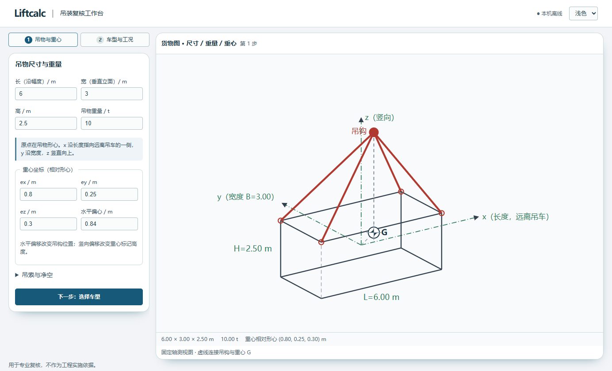

# liftcalc · 汽车吊吊装能力反查

> **给定吊重，直接回答"能不能吊、最远多少米、多高"**，代替人工翻原厂性能表。
>
> 纯本地、离线、不联网、无 AI。自用工具，不做商业功能。

---

## Windows 单机桌面工作台



工作台默认最大化，左侧输入工况并查看结果，右侧查看及导出图纸。默认使用 Refract 浅色主题，右上角可切换 Dusk 深色主题。点击吊装示意图可打开大图，在图上滚动滚轮可围绕指针缩放（100%–400%），按住左键可手型拖动。点击百分比可恢复全图，按 Esc 或点击“关闭”返回。

[查看只读 CAD 核图界面](docs/handover/assets/refract-cad.png)

在安装 Python 3.12 或更高版本、Microsoft Edge WebView2 运行时的 Windows 电脑上，双击仓库根目录的 `启动单机工作台.cmd`。首次启动会在项目的 `.venv` 中安装桌面依赖，需要联网。以后可离线启动。界面和 CAD 资源随仓库提供。

1. 在左栏选择机型和配置，输入吊件、索具与吊钩重量。吊钩留空时读取机型库，缺失时请补录。按最远幅度或指定幅度查表，可同时约束钩高。
2. 点击“计算并生成图纸”，在左栏查看采用幅度、臂长、起升高度和负荷率。编辑工况后请重新计算。
3. “CAD 核图”支持本次 DXF 和 32 MB 以内的本地 DXF。按住鼠标左键平移，滚动滚轮缩放，点击“全图”恢复视野。
4. 可导出 DXF、SVG、PNG 或 Word 复核报告。图示轴数、车辆外形及净空用于表达工况，工程尺寸以厂家资料为准。

工作台采用 Vue 3、TypeScript、pywebview 和现有 Python 计算内核。修改界面后在 `frontend` 目录运行 `pnpm install --frozen-lockfile` 和 `pnpm run build`，将生成的 `src/liftcalc/dusk_static` 随源码一起提交。已安装桌面扩展的环境也可以运行 `python -m liftcalc.dusk`。

## 一、它能回答什么问题

**问：10 吨货，我这台 70 吨车能吊多远？**

```
能吊 ✅  最远 10.0 m
对应工况：臂长 25.98 m、仰角 67.6°、起升高度 24.43 m
该格额定 15.5 t，负荷率 0.706（余量 29%）
```

**问：换台 200 吨的呢？**

```
能吊 ✅  最远 30.0 m（臂长 35.5 m、额定 15.3 t、负荷率 0.833）
```

**问：两台吊车抬呢？**

```
总计算荷载 21.17 t，按 60%/40% 分配，不同步系数 1.1，每台上限 80% → 两台均满足
  主吊 13.97 t → 能吊，最远 9 m（负荷率 0.75）
  辅吊  9.31 t → 能吊，最远 10 m（负荷率 0.60）
```

**两台取交集，实际按 9 米控制。**

---

## 二、判定规则（先看这一节）

| 项 | 规则 |
|---|---|
| 单机负荷率上限 | **90%** |
| 双机每台上限 | **80%** |
| 查表方式 | **取下一档，绝不插值**（原厂说明第 7 条） |
| 计算荷载 | 吊件 + 吊钩 + 索具 × 动载系数（默认 1.1） |
| 吊钩自重 | 不填时**自动从机型库取**；库里也没有会警告"未含吊钩" |
| 查不到 | 明确报"无性能数据"，**不会给半截答案** |

> **"最远"是怎么来的**：把该机型所有"臂长 × 幅度"格子逐个试，算出负荷率，取满足条件且幅度最大的那一格。

---

## 三、快速开始

### 3.1 环境

```powershell
cd <仓库根>
python -m venv .venv
.venv\Scripts\activate
pip install pint numpy pydantic python-docx ezdxf typer PyYAML pytest hypothesis pymupdf pillow
```

依赖装好后，直接用包装脚本（会自动设好 PYTHONPATH）：

```powershell
.\liftcalc.ps1 --version
.\liftcalc.ps1 selftest
```

### 3.2 建库（第一次用必做）

```powershell
.\liftcalc.ps1 data build --pack src/liftcalc/data/pack --out data/liftcalc.sqlite
.\liftcalc.ps1 data validate --db data/liftcalc.sqlite
```

### 3.3 反查

```powershell
# 单机：10 吨货，QY70K-1
.\liftcalc.ps1 capability --model QY70K-1 --payload 10 --hook 0.616 --rigging 0.3 --out out\cap.json

# 双机：两台 QY70K-1 抬 20 吨，60/40 分配，不同步系数 1.1
.\liftcalc.ps1 capability --mode dual --model QY70K-1 --second-model QY70K-1 `
    --payload 20 --hook 0.616 --rigging 0.5 --asynchronism 1.1 --out out\dual.json
```

参数说明：

| 参数 | 含义 | 不填会怎样 |
|---|---|---|
| `--payload` | 吊件重量 t | **必填** |
| `--hook` | 吊钩重量 t | 自动取机型库主钩自重 |
| `--rigging` | 索具重量 t | 按 0 计 |
| `--dynamic-factor` | 动载系数 | 默认 1.1 |
| `--limit` | 负荷率上限 | 单机 0.90 / 双机 0.80 |
| `--required-height` | 所需起升高度 m | 不做净空校核 |
| `--load-width` / `--load-height` | 图示吊物宽/高 m | 3.2 / 3.8（只影响立面图） |
| `--clearance` | 图示吊物底距地净空 m | 1.0（只影响立面图） |

### 3.4 出计算书

```powershell
.\liftcalc.ps1 report --in out\cap.json --out out\吊装计算书.docx
```

计算书包含：计算依据、设计参数、反查结论、临界工况、**详细计算过程**（荷载组成 / 逐臂长扫描 / 临界格算术）、结果汇总、结论、输入一览。

### 3.5 出图

```powershell
# 矢量：SVG（可插文档）、DXF（可进 CAD）
.\liftcalc.ps1 draw --in out\cap.json --out out\图.svg --format svg
.\liftcalc.ps1 draw --in out\cap.json --out out\图.dxf --format dxf

# PNG 预览（没装 CAD 时看这个）
.\liftcalc.ps1 render --in out\cap.json --out out\png
```

图的内容：

- **图幅**：A3，竖幅/横幅**自动选**（谁的比例大用谁），图框 + 分区 1–8 / A–H
- **立面**：汽车吊、伸缩臂（含搭接分界）、变幅油缸、臂端滑轮组、起升绳、吊钩组、吊索、吊物
- **尺寸链**：R / f / g（地面以下）、H / Hz / h1–h3（吊物左侧）、h0（吊钩到臂端）、L（沿臂）、a（仰角弧）、E（铰点高），全部带尺寸界线与箭头
- **引线标注**：吊钩中心、主臂、索具、回转中心
- **图面**：右上起重性能表、右下标题栏（含设计/校核/审核/批准）、左下说明 5–6 条

比例是**真实的**：按内容外包框在标准比例梯 1:50 / 1:100 / 1:150 / 1:200 … 里取最大可容的一档，
所以标题栏、说明里写的比例与图上量出来的一致（过去写死 1:100，实际是 1:131）。

> **同一矢量车身**：SVG、PNG、DXF 共用按参考图描点重绘的驾驶室、上车、车架与轮组，放大不发虚。轴数只按机型额定吨级示意：≤100 t 四轴，100–300 t 六轴，≥300 t 八轴；轴距与轴荷不是厂商参数。`drawing/assets/crane_body.png` 只是描点来源，不再直接贴图。

---

## 四、数据覆盖

### 4.1 已录入

| 机型 | 吨位 | 类型 | 配置 | 格点 |
|---|---|---|---|---|
| QY70K-1 | 70 t | 汽车吊 | 7 | 77 |
| QY100H-3 | 100 t | 汽车吊 | 9 | 152 |
| QY130H-1 | 130 t | 汽车吊 | 18（配重 30/20 t 两套） | 273 |
| QAY200 | 200 t | 全地面 | 12 | 214 |
| XCT25L5_Y | 25 t | 汽车吊 | 15（固定全配重 5.8 t） | 192 |
| XCT60_Y | 60 t | 汽车吊 | 15（固定 5.5 t + 活动 1 t） | 204 |
| XCT100_1 | 100 t | 汽车吊 | 29（全配重 45 t，按伸缩码分列） | 432 |
| 三一 STC500 | 50 t | 汽车吊 | 11（固定全配重 3.5 t） | 183 |
| 三一 STC550C5 | 55 t | 汽车吊 | 15（固定 5.2 t + 活动 2.3 t） | 216 |
| 三一 STC750 | 75 t | 汽车吊 | 9（固定 4.5 t + 活动 2 t） | 154 |
| 三一 STC1100T7 | 110 t | 汽车吊 | 14（全配重 38.5 t，侧后方） | 242 |
| 三一 STC1200T7 | 120 t | 汽车吊 | 14（巴西缓速器版，全配重 36.2 t） | 234 |
| 三一 STC1600T7 | 160 t | 汽车吊 | 28（全配重 52 t，常规位和全后移各 14 组） | 463 |
| 三一 STC2000C8-8 | 200 t | 汽车吊 | 14（2024 款，全配重 61 t） | 281 |
| 三一 STC2400C8PHEV | 240 t | 汽车吊 | 18（全配重 71 t，后移 R 位） | 394 |
| 三一 STC3000C8-8 | 300 t | 汽车吊 | 17（全配重 73.5 t，普通主臂） | 352 |
| **合计** | | | **245** | **4063** |

下列六款采用全配重、主臂、支腿全伸、360° 工况。页码从 PDF 封面起算，每个入库格点带有对应页的链接。

| 机型 | 支腿跨距（纵 × 横）及条件 | 格点幅度 | 原厂性能表 |
|---|---|---|---|
| XCT25L5_Y | 5.23 × 6.4 m，第五支腿支好 | 3–32 m | [规格书 PDF 第 14–15 页](https://www.wme.cn/xcmg-xct25l5y/xcmg-xct25l5y.pdf#page=14) |
| XCT60_Y | 6.1 × 7.1 m，第五支腿支好 | 3–34 m | [规格书 PDF 第 9–10 页](https://cdn2.antbuildz.com/images/801140e237a2c5fee8df6b44b.pdf#page=9) |
| XCT100_1 | 8.45 × 7.9 m，按表底五位伸缩码选择 | 3–54 m | [徐工欧洲规格书 PDF 第 15–16 页](https://xcmg-eu.com/wp-content/uploads/2021/12/XCT100.pdf#page=15) |
| STC500 | 6 × 7.2 m，11.5–43 m 主臂，按第 2 节至顶节伸出率选择 | 3–34 m | [三一规格书 PDF 第 7 页左表](https://sanyglobal-img.sany.com.cn/product/picture_album/20200929/STC500-13%20Broch-224154.pdf#page=7) |
| STC550C5 | 6.05 × 7.4 m，第五支腿支好，11.6–45 m 主臂 | 3–34 m | [三一规格书 PDF 第 10 页](https://sanyglobal-img.sany.com.cn/sanyglobal-com-prd/prod/20251226/Sany-brochure-STC550C5-20240329-EN-CN_200143.pdf#page=10) |
| STC750 | 6.1 × 7.6 m，11.8–45 m 主臂，按伸缩组合选择 | 3–32 m | [三一规格书 PDF 第 7 页右表](https://www.sanyglobal.com/all/d/file/p/2017-03-02/af0f448e4762f6053306cb254e378409.pdf#page=7) |

这六款主臂表的空格、逐格钩高和仰角均留空。表中的幅度范围汇总了该机型所有伸缩组合，每个组合只能查到原表列出的幅度。

计算时按实车核对吊钩自重、额定能力及倍率。XCT100_1 标配 75 t 主钩自重 0.530 t，选配 130 t 主钩自重 1.017 t。STC500 的主钩有 0.610 t 和 0.555 t 两种，STC750 的两种主钩分别为 0.800 t（75 t 钩）和 0.320 t（30 t 钩）。STC550C5 规格书的吊钩参数表与性能表备注所列自重有出入，库中主副钩自重均留空，按实车填写。

#### 110–300 t 三一汽车吊的查表条件

下表六款均采用支腿全伸的主臂表。计算时按实车填写吊钩自重；各格点均可回到对应的 PDF 页。带星号的特殊额定值和原表空格均未录入。

| 车型 | 适用范围和转录说明 | 厂家原表 |
|---|---|---|
| STC1100T7 | 页脚限定侧方及后方作业。13.9 m 主臂的 3 m 和 3.5 m 两格有星号。 | [第 10 页](https://sanyglobal-img.sany.com.cn/product/picture_album/20211027/Sany_crane-brochure_STC1100T7-150757.pdf#page=10) |
| STC1200T7 | 巴西缓速器版，360°。2.5 m 幅度的 120 t 格点需辅助装置。第 8 页尺寸图与第 9 页规格表对支腿纵横顺序的标注相反，数据库的纵横跨距留空。 | [第 16 页](https://sanyglobal-img.sany.com.cn/sanyglobal-com-prd/prod/20251226/Sany-brochure-STC1200T7-Brazil-Retarder-20231018-EN-CN_195416.pdf#page=16) |
| STC1600T7 | 360°，按实际配重位置选表。带星号的格点需提高倍率并使用指定吊钩。 | [全后移第 23 页](https://sanyglobal-img.sany.com.cn/sanyglobal-com-prd/prod/20251230/Sany-brochure-STC1600T7-20230606-EN-CN_220415.pdf#page=23)、[常规位第 25 页](https://sanyglobal-img.sany.com.cn/sanyglobal-com-prd/prod/20251230/Sany-brochure-STC1600T7-20230606-EN-CN_220415.pdf#page=25) |
| STC2000C8-8 | 2024 款，360°。第 7 页左表的 21.0 m、39.8 m 与第 6 页曲线标注不一致，另有两列同标 59.4 m。四列均暂缺。 | [第 7 页左表](https://cos-www.sanygroup.com/2024/03/26/STC2000C8-8%2824%E6%AC%BE%29%E5%8D%95%E8%A1%8C%E6%9C%AC%E4%B8%AD%E6%96%87%E7%89%8820240129.pdf#page=7) |
| STC2400C8PHEV | 360°，配重后移，按 2024 年 5 月手册封面的型号入库。产品页写作 STC2400C8-8PHEV。 | [第 11 页](https://cos-www.sanygroup.com/2024/07/03/STC2400C8PHEV%E5%8D%95%E8%A1%8C%E6%9C%AC%E4%B8%AD%E6%96%87%E7%89%8820240528%281%29.pdf#page=11) |
| STC3000C8-8 | 360°。双星号表示能力等级，单星号要求辅助装置。40 m 主臂在 6 m、6.5 m 幅度的表值依次为 83.9 t 和 87.0 t，该列暂缺。普通主臂已收录的最大表值为 124.8 t。 | [第 11 页](https://cos-www.sanygroup.com/2024/07/19/STC3000C8-8%E5%8D%95%E8%A1%8C%E6%9C%AC%E4%B8%AD%E6%96%87%E7%89%8820240711.pdf#page=11) |

### 4.2 未录入

| 机型 | 原因 |
|---|---|
| QAY300（300 t） | 主臂表 23 列，同一臂长重复 2~3 次（伸缩组合不同），扫描件右半段列宽不均，读不准 |
| QAY500（500 t） | 20 种组合 × 47 幅度 ≈ 940 格，规模过大 |

**这两个机型查询会明确报"没有性能数据"，不会返回错的数。**

补录的正路是**厂商官网的规格书 PDF**（带文字层，可直接解析），不是扫描件。工具 `tools/extract_pdf_table.py` 已具备这个能力，样例见 `docs/handover/original/示例规格书_XCT130L8_1.pdf`。

### 4.3 新增机型

1. 在 `src/liftcalc/data/pack/crane/models.csv` 加一行
2. 建 `<型号>.capacity.csv`（列名见 `data/pack/crane/QY70K-1.capacity.csv`）
3. 跑 `data crane-validate --path ... --tonnage 70` 校验
4. 跑 `data build` 建库
5. 用 `capability` 验一次

**同一臂长有多个工况时，用 `config` 列区分**（如"配重30t"），否则会被判成重复行。

---

## 五、范围

**只做汽车吊。** 其余模块代码保留、测试仍跑，但当前版本不使用：

| 模块 | 状态 |
|---|---|
| 能力反查、双机抬吊 | ✅ 使用中 |
| 计算书、出图 | ✅ 使用中 |
| 吊耳 `lifting.eye`、吊梁 `lifting.beam`、索具 `lifting.rigging` | ⏸ 暂不使用 |
| 截面 `sections`、重心 `geometry` | ⏸ 暂不使用 |
| 平面框架 `fea`、规范校核 `codecheck` | ⏸ 暂不使用 |

> "暂不使用"＝保留实现与测试，命令行仍可调用，但不进当前流程和计算书模板。

---

## 六、常见问题

**查某机型报"没有性能数据"**
该机型没录入（见 4.2），或数据库没建（先跑 `data build`）。

**结果里出现"未含吊钩"的警告**
机型库里没有该机型的主钩自重。**必须补填 `--hook`**，否则计算荷载偏小、最远幅度偏大，结果偏不安全。

**为什么 10 吨比 30 吨吊得远？**
不是车的问题，是臂长：轻货能用长臂（25.98 m 臂在 10 m 幅度还有 15.5 t），重货只能用短臂。

**能不能插值？**
不能。原厂说明第 7 条要求取下一档。程序严格按格点取值。

**300/500 吨什么时候能用？**
拿到官方规格书 PDF 就能补，一页大约半天。

---

## 七、目录

```
src/liftcalc/
  crane/capability.py   反查核心
  data/                 机型表读写、校验、导入
  services/calc.py      工况 JSON → 结果 JSON
  report/render.py      Word 计算书
  drawing/              绘图（primitives / style / dim / sheet / body / figures / svg / dxf / png）
data/pack/crane/        机型表 CSV（数据源，手工维护）
tools/                  转录、PDF 提取、DXF 预览、PNG 渲染
tests/                  138 个测试函数（含 test_drawing.py 的立面图断言）
docs/handover/          交接文档（含原版参照图与待办）
```

---

## 八、限制与免责

- 当前覆盖 **15 款汽车吊、1 款全地面起重机，共 4063 个主臂格点**。
- 立面图是**能力反查示意图**：吊物按方框示意，车身、臂架为简化线稿，不是施工图
- 未做风载、偏心、多机不同步的动力分析，只用系数简化
- 原厂表只给**支腿全伸**工况
- 计算书里的"限值"（负荷率 90%/80% 等）是**工程惯例取值，待专家核定**
- 本工具为个人学习与复核参考，**输出不得作为工程实施依据**

---

## 九、给接手开发的人

看 [docs/handover/交接文档.md](docs/handover/交接文档.md)：程序结构、数据规范、绘图层设计、7 个踩过的坑、四阶段任务清单、验收方法。原程序参照图与 DXF 模板已随仓库附带。
