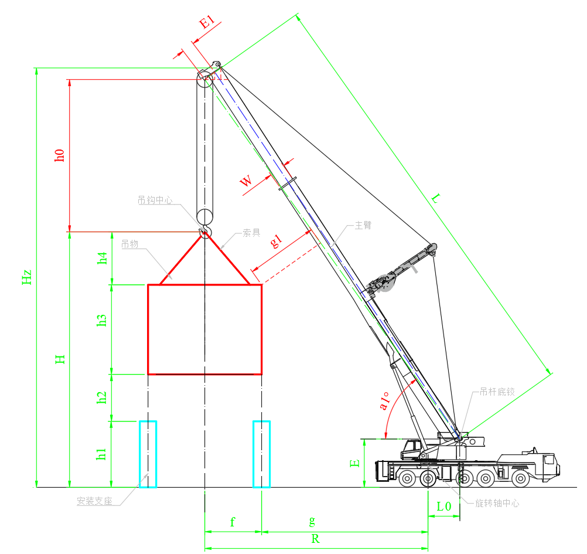
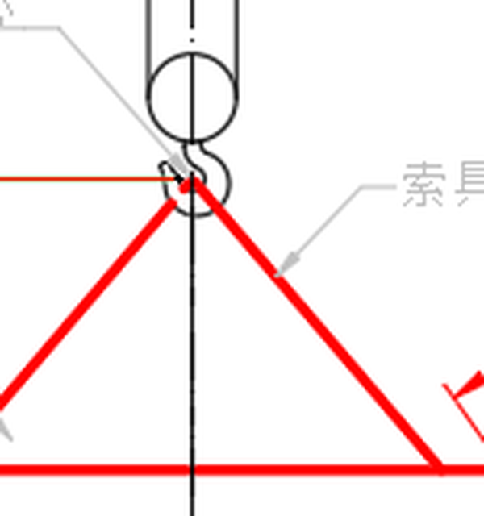
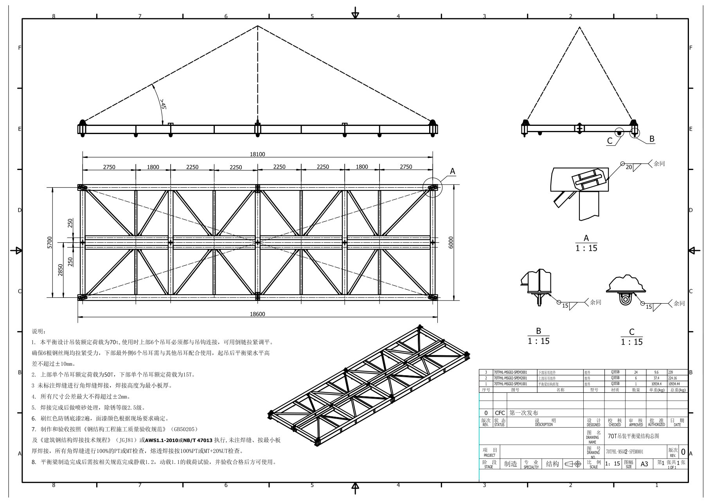
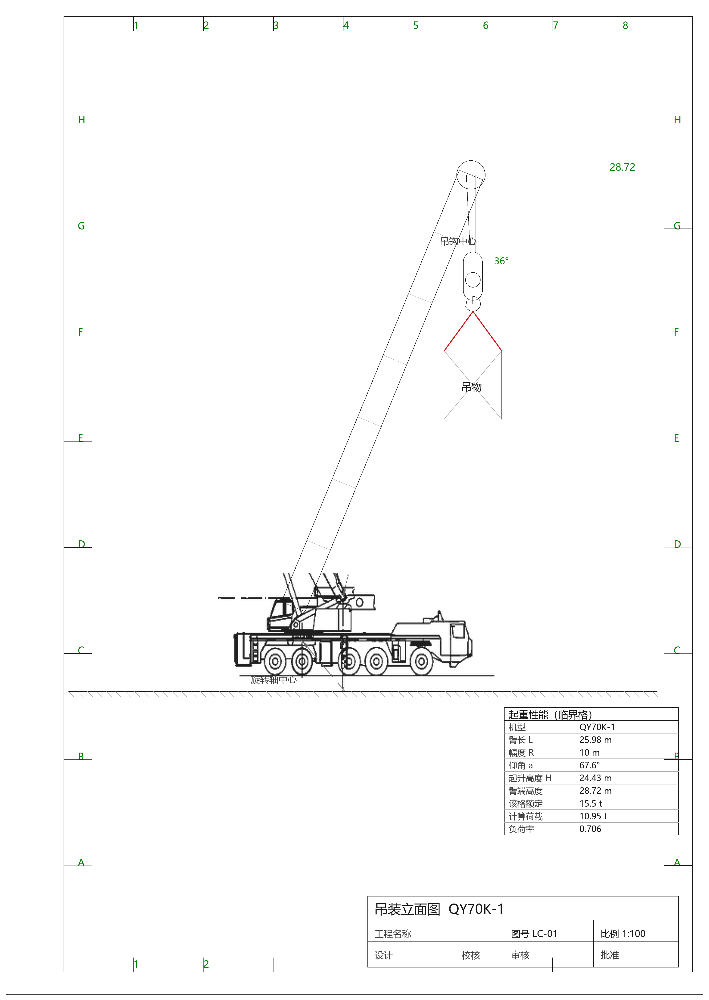

# 吊装计算工具 · 交接文档

**交接日期**：2026-11
**交接范围**：`D:\学习日志\吊装\liftcalc`（程序本体）+ `D:\学习日志\吊装\研究`（前期研究资料）
**接手人要求**：熟悉 Python；能看懂工程图纸与起重性能表；如果要做图纸，还需要熟悉 CAD 的 DXF 格式

---

## 一、这份文档怎么用

这个项目现在处于"**计算部分可用、绘图部分未达标**"的状态。请按下面的顺序看：

1. **第二、三节**——先跑起来，确认环境没问题
2. **第四~七节**——理解数据与计算，这部分是稳定的，改动风险低
3. **第八节（重点）**——绘图系统，这是本次交接的主要工作
4. **第九节**——已知问题清单，按优先级排好了，可以直接当任务单

第八节里放了**原版程序的 4 张参照图**，都在 `docs/handover/assets/`，请对着看。**接手后第一件事应该是把原版图和当前实现对一遍**，明确差在哪。

---

## 二、项目现状一句话

| 模块 | 状态 | 说明 |
|---|---|---|
| 起重能力反查（给定吊重求最远幅度） | ✅ 可用 | 114 个测试函数全部通过 |
| 双机抬吊反查 | ✅ 可用 | 每台 80% 上限、60/40 分配、不同步系数 |
| 计算书（Word） | ✅ 可用 | 含详细推导，无代码内容 |
| 吊装立面图 | ⚠️ **未达标** | 结构对，但精细度远不如原版；详见第八节 |
| 300 t / 500 t 机型 | ❌ 未录入 | 见第五节，数据源问题 |

---

## 三、快速上手

### 3.1 环境

```
Python 3.12（venv 位于 liftcalc\.venv，用 --system-site-packages 创建）
依赖：pint, numpy, pydantic, python-docx, ezdxf, typer, PyYAML,
      pytest, hypothesis, pymupdf, PIL(Pillow), matplotlib
```

### 3.2 每次开新终端要先设 PYTHONPATH

```powershell
cd D:\学习日志\吊装\liftcalc
$env:PYTHONPATH='D:\学习日志\吊装\liftcalc\src'
$py='.\.venv\Scripts\python.exe'
```

### 3.3 三条必需命令

```powershell
# 1) 跑测试（必须全绿才能改数据）
& $py -m pytest -q --no-header -p no:cacheprovider

# 2) 从 CSV 重建数据库
& $py -m liftcalc.cli.main data build --pack src/liftcalc/data/pack --out data/liftcalc.sqlite

# 3) 反查示例：10 吨货，70 吨车
& $py -m liftcalc.cli.main capability --model QY70K-1 --payload 10 --hook 0.616 --rigging 0.3 --out out\a.json
```

### 3.4 出计算书与图

```powershell
& $py -m liftcalc.cli.main report --in out\a.json --out out\计算书.docx
& $py -m liftcalc.cli.main draw   --in out\a.json --out out\图.svg --format svg
& $py -m liftcalc.cli.main draw   --in out\a.json --out out\图.dxf --format dxf

# PNG 预览（没有 AutoCAD 时用这个看图）
& $py tools\render_png.py out\a.json out\png
```

---

## 四、目录结构与职责

```
liftcalc/
├─ src/liftcalc/
│  ├─ core/        单位(pint)、结果契约、容差、异常、公式注册表
│  ├─ crane/       ★ capability.py 反查核心；select.py 正算负荷率
│  ├─ data/        机型表 CSV 的读写、校验、导入、数据库仓储
│  ├─ services/    calc.py 把 case(JSON) 跑成 result(JSON)
│  ├─ report/      render.py 生成 Word 计算书
│  ├─ drawing/     ★ 绘图：primitives / figures / svg / dxf
│  │  └─ assets/   原版车身素材 crane_body.png
│  ├─ sections/    截面特性（暂不使用）
│  ├─ geometry/    重心（暂不使用）
│  ├─ lifting/     吊耳/吊梁/索具（暂不使用）
│  ├─ fea/         平面框架（暂不使用）
│  └─ codecheck/   规范校核系数（暂不使用，系数待专家核定）
├─ data/pack/      ★ 数据源（手工维护的 CSV）
│  └─ crane/       models.csv + 每个机型一个 *.capacity.csv
├─ tools/          ★ 转录、PDF 提取、DXF 预览、PNG 渲染
├─ tests/          14 个测试文件
├─ docs/handover/  ★ 本文档与参照图
└─ out/            产物（计算书、SVG、DXF、PNG）
```

**规模**：Python 49 个文件 5287 行；测试 14 个文件 1115 行，114 个测试函数。

---

## 五、数据层

### 5.1 数据源格式

`data/pack/crane/models.csv` —— 每个机型一行：

| 字段 | 含义 | 备注 |
|---|---|---|
| model | 型号 | 如 QY70K-1 |
| brand | 品牌 | 徐工 |
| tonnage_class_t | 吨位 | 用于校验不要超过额定 |
| crane_type | 类型 | truck / all_terrain |
| counterweight_t | 配重 | 可空 |
| hook_main_t | 主钩自重 | **重要**：未填则计算荷载不含吊钩 |
| hook_aux_t | 副钩 | 可空 |
| max_outrigger_reaction_kN | 最大支腿反力 | 原厂给才填 |
| self_weight_t | 整机自重 | 算倾覆必须有 |
| outrigger_lx_m / ly_m | 支腿跨距 | 纵向/横向 |

`data/pack/crane/<型号>.capacity.csv` —— 每个格点一行：

```
boom_len_m, radius_m, rated_load_t, boom_angle_deg,
boom_max_angle_deg, boom_min_angle_deg, lift_height_m,
parts_of_line, source_page, note, config
```

**关键**：`config` 列用来区分同一臂长的不同工况（配重不同、伸缩组合不同）。**不填则默认为该臂长的唯一工况**。QY130H-1 有"配重30t / 配重20t"两套，就是用这列分开的。

### 5.2 录入时的校验（`data/crane_table.py`）

导入或校验时会逐臂长检查：

1. 幅度严格递增
2. 额定值单调不增
3. 不超过吨位
4. 首/末行仰角与表头最大/最小仰角一致（有仰角列时）
5. 起升高度单调不增
6. 记录最小幅度，过大会提示"是否漏录小幅度"

**任何一条不过，`data build` 会拒绝建库**，这是有意设计的：宁可不入库，也不带错数据。

### 5.3 当前覆盖

| 机型 | 吨位 | 配置 | 格点 | 来源页 |
|---|---|---|---|---|
| QY70K-1 | 70 t | 7 | 77 | p1 |
| QY100H-3 | 100 t | 9 | 152 | p2 表 / p3 参数 |
| QY130H-1 | 130 t | 18 | 273 | p4 两张表 / p5 参数 |
| QAY200 | 200 t | 12 | 214 | p6 参数 / p7 表 |

合计 **4 机型 / 46 配置 / 716 格点**。

### 5.4 未录入的两个机型（重要）

- **QAY300**：主臂性能表 23 列，同一臂长重复 2~3 次（伸缩组合不同）。扫描件右半段列宽不均，两次切图读出不同数列，判定为不可靠，**未入库**。已读的 16 列数据在 `tools/qay300_data.py`，带 `COMPLETE = False`，脚本拒绝写 CSV。
- **QAY500**：20 种组合（X/Y 配重 × A/B 杆头）× 47 幅度，约 940 格，规模过大。

**建议**：这两个机型改用**官方规格书 PDF 直读**，不要再用扫描件。检查 `tools/extract_pdf_table.py`——它已经在 `XCT130L8_1` 上验证过（一页提取 292 格、13 个组合）。

> 注意：原程序 `D:\学习日志\吊装助理\LiftParameter\` 下有 101 个 PDF（后缀改成了 `.bz`），包含 XCA300、XCA500，但 **96 个加密**，口令在程序内部，未取得。**不要尝试破解**。

### 5.5 新增一个机型的步骤

1. 把 `models.csv` 加一行，`<型号>.capacity.csv` 建好
2. 跑 `data crane-validate --path ... --tonnage 70` 看校验结果
3. 跑 `data build` 建库
4. 跑一次 `capability` 确认能查到
5. 补一个测试到 `tests/test_capability_boundaries.py`

---

## 六、计算层

### 6.1 反查算法（`crane/capability.py`，99 行）

```
计算荷载 = 吊件 + 吊钩 + 索具 × 动载系数
逐格判： 计算荷载 ÷ 该格额定值 ≤ 上限
取满足条件的所有格点中，幅度最大的那一格
```

- 单机上限 **0.90**，双机每台 **0.80**（`SINGLE_LIMIT` / `DUAL_LIMIT`）
- **绝不插值**：原厂说明第 7 条要求取下一档。这一点是硬约束，不要改成插值
- 全表都超限时，返回"最接近的格点 + 缺口多少吨"，不是简单报错

### 6.2 双机（`find_dual` + `split_by_ratio`）

- 总荷载按 `left_share`（默认 0.6）分配
- 每台分到的荷载再乘 `asynchronism`（不同步系数，默认 1.0，工程上常用 1.1~1.25）
- 两台各自反查，**交集才算通过**

### 6.3 吊钩自重的处理（容易踩的坑）

`services/calc.py` 里：**用户不填吊钩重量时，自动从机型库取 `hook_main_t`**，并在结果里加提示。

如果机型库也没有，会加一条警告："本次计算荷载未含吊钩——结果偏不安全"。**这个警告不能删**，因为漏算吊钩会让最远幅度虚增（实测 QAY200 从 30 m 虚增到 32 m）。

---

## 七、计算书（`report/render.py`，331 行）

结构（节号写死在代码里，改动要同步）：

```
1 计算依据
2 设计参数
3 计算过程
  3.1 反查结论
  3.2 临界工况
  3.3 反查详细计算过程
      3.3.1 计算荷载的组成
      3.3.2 逐臂长扫描结果   ← 最有用，逐档说明"再远一档为什么不行"
      3.3.3 临界格点的判定算术
4 结果汇总
5 结论
附录 A 计算输入一览
```

**约定：计算书里不能出现代码**。具体要求：

- 不出现 JSON、花括号、字段名
- 不出现内部标识符（`capability.critical` → 用 `_CHECK_TITLES` 映射成"临界工况"）
- 参数表用中文名带单位（`payload` → "吊件重量 (t)"）
- 单机时不要显示双机专用参数（`_DUAL_ONLY` 过滤）

---

## 八、绘图系统（本次交接的重点）

### 8.1 现状与目标

| | 状态 |
|---|---|
| 数据结构、坐标体系、三种输出 | ✅ 已完成 |
| 图框、标题栏、性能表、说明 | ✅ 已完成 |
| 车身（原版素材贴图） | ✅ 已完成 |
| 臂架、吊钩组、吊物、尺寸线 | ⚠️ 结构对，细节不足 |
| 精细度 | ❌ **远不如原版**，这是主要待办 |

### 8.2 图元模型（`drawing/primitives.py`，70 行）

全部坐标单位 **mm**，**y 轴向上**（和 CAD 一致，SVG 输出时会翻转）。

```python
Line(x1, y1, x2, y2, layer)          # 直线
Circle(cx, cy, r, layer)             # 圆
Polyline(points, closed, layer)      # 折线（折线闭合成多边形）
Text(x, y, content, height, layer)   # 文字，height 是字高 mm
Image(x, y, w, h, path)              # 位图块（左下角定位）
```

图层（决定颜色和线宽）：

| 图层 | PNG 颜色 | 用途 |
|---|---|---|
| OUTLINE / TEXT | 黑 | 实体轮廓、文字 |
| DIM | **绿** | 尺寸线 |
| CENTER | 红 | 中心线 |
| RIGGING | **深红加粗 3×** | 索具 |
| THIN | 浅灰 | 辅助线、剖面线 |
| HIDDEN | 灰 | 虚拟线 |
| NOTE | 灰 | 说明文字 |

### 8.3 三个输出器

| 文件 | 输出 | 注意 |
|---|---|---|
| `drawing/svg.py` | SVG | y 轴要翻转；Image 转 base64 内嵌 |
| `drawing/dxf.py` | DXF | 按图层建 CAD 层；**Image 不支持**（位图不进矢量图） |
| `tools/render_png.py` | PNG | 自绘，用 `C:\Windows\Fonts\msyh.ttc` 画中文 |

> **为什么 PNG 渲染器要自己写**：ezdxf 自带的 matplotlib 后端在这台机器上渲染不了中文（`mstmc.ttf` 报 `bad sfntVersion`）。自己写一个反而可控。

### 8.4 吊装立面图的组成（`drawing/figures.py` 的 `elevation_figure`，共 439 行里的主要部分）

坐标系：**旋转轴中心为原点 (0,0)**，x 向右（幅度方向），y 向上（高度）。图幅 A3 竖幅 297×420 mm，1:100。

绘制顺序：

1. **图框**：外框 + 内框（左 25 / 下 10 / 右 5 / 上 5），分区编号 1–8 / A–H
2. **地面**：横线 + 一排短斜线（剖面线）
3. **车身**：贴 `assets/crane_body.png`（16 m 长，铰点对齐原点上方 4.7 m）
4. **臂架**：双线（半宽 0.7 m）+ 沿臂长 7 等分刻度线
5. **臂端滑轮**：圆
6. **起升绳**：臂端 → 吊钩组顶部，两股
7. **吊钩组**：竖筒 0.52×2.70 m（上下圆角）+ 筒内滑轮圆 + 底部弯钩（250° 弧）
8. **吊物**：方框 3.2 m 宽 + 对角交叉线
9. **吊索**：钩口 → 吊物两上角，RIGGING 层（红色加粗）
10. **尺寸**：R（幅度）、H（起升高度）、臂端高度、L、a、吊索夹角，全部带开口箭头
11. **右下**：起重性能表（9 行）+ 标题栏（图名/工程号/图号/比例/签署）
12. **左下**：说明 5 条

### 8.5 原版参照图（**请重点对照**）

**① 原版吊装立面（汽车吊，这是主要目标）**



要观察的细节：
- 车身是**极其精细的五轴汽车吊线稿**（悬挂、轮系、支腿油缸、驾驶室）
- 臂架是**多节伸缩臂**，有节与节的搭接线
- 尺寸链是**绿的**，红的是索具和吊物，青的是支座
- 尺寸标注有 h0、h1~h4、H、Hz、E、L、W、El、R、f、g、L0 一整套
- 标注引线带**箭头指向具体部位**，不是干放在那里

**② 原版吊钩放大 4 倍**



要观察的细节：
- 吊钩组是**竖长筒体**，筒内有一个**滑轮圆**
- 筒底接**弯钩**，钩口朝左下，开口约 250°
- 吊索从**钩口**呈 V 形向两侧拉开，是**粗红线**
- 两根起升绳从臂端垂到筒顶，**绳子在筒内绕滑轮穿过**

**③ 原版吊装立面（履带吊，另一种工况）**


这份的价值在于它展示了**障碍物、安装支座、多段尺寸链**的画法。如果以后要支持"越过障碍物吊装"，参照这张。

**④ 原版 CAD 图纸（平衡梁，A2 图幅）**



这是原版的**正式出图**标准：图框、网格、材料明细表、标题栏、签署栏、局部放大详图（A/B/C，1:15）、焊接符号、技术要求。

如果要做"能交付的图纸"（而不是示意图），目标应该是这张。

**⑤ 当前实现（对照用）**




### 8.6 已知差距（按优先级）

**P0 —— 直接影响观感**

1. **车身素材是位图贴的**，放大后是马赛克。应改为**矢量块**：从原版 PNG 描点，或从原版 DWG 提取块。
2. **臂架是简单双线**，没有伸缩节分界、没有油缸、没有臂头滑轮组细节。
3. **吊钩组缺绳索绕线**（原版筒体内能看到绳子绕过滑轮）。

**P1 —— 标注体系**

4. **尺寸链不全**：原版有 h0~h4（吊钩中心高、吊物高、支座高、净空），我们只有 H、R、L、a。
   要补齐需要新增输入：吊物高度、安装支座高度、要求的底部净空。
5. **引线标注不专业**：原版是"箭头指向 + 文字在旁"，我们现在是文字浮在空白处。

**P2 —— 出图能力**

6. **没有局部放大详图**（原版的 A/B/C 详图 1:15）。
7. **没有材料明细表**（原版右下那张）。

### 8.7 另一条路：改造原版 DXF 模板

`tools/sheet_from_template.py`（79 行）已经跑通这条路：

1. 读 `D:\学习日志\吊装助理\Dxf\Liftingdg.dxf`
2. 删掉模型空间的几何实体（吊耳的圆孔、轮廓、尺寸），保留块引用（图框、标题栏、材料表）
3. 按图框包围盒自动定位，把吊装立面画进空白区
4. 输出 DXF + PNG

**优点**：图框、标题栏、材料表、签署栏**直接是原版的**，不用重画。
**缺点**：原版的块是**嵌套绝对坐标**，删几何时容易连图框一起删掉；吊耳几何有一部分封在块里，删不干净。

**要继续做的话**：
- 用 `ezdxf.bbox` 精确定位图框内可用区域
- 逐个 INSERT 判断是"图框类"还是"图形类"，按块名白名单处理
- 修改标题栏文字（ATTRIB），把图名、图号、比例写进去

### 8.8 踩过的坑（**请务必看，能省很多时间**）

1. **DXF 块变换**：`tools/dxf_preview.py` 里 `Xf` 类处理平移/旋转/缩放。最初漏了旋转和缩放，渲染出来整张图散架——不是文件坏了，是渲染器错了。
2. **中文转义**：DXF 里部分文字是 `\U+XXXX` 形式，要先解码成汉字再画。
3. **字体**：ezdxf 的 matplotlib 后端读不了 `mstmc.ttf`，中文会丢。用 `msyh.ttc` 自绘。
4. **扫描件切图**：不要"找准列边界"，要"目标列居中、左右各留余量"。准不准无所谓，只要别把列切掉。QAY300 那张表就是被切掉首位数字才放弃的。
5. **PowerShell 改文件会踩编码坑**：中文替换用 PowerShell 的 here-string 极易失败（换行符 CRLF/LF 不一致）。**改代码请用 Python 脚本**。
6. **列数会数错**：QAY300 我一开始数成 18 列，实际 23 列。**录表前先单独渲染表头那一行**确认列数。
7. **1 m ≠ 1 图形单位**：原版图框是按 1:10 单位画的（A3 图纸实际跨度约 4200 单位）。画图前先量图框包围盒。

---

## 九、任务清单（接手后可直接按此推进）

### 阶段一：把图做对（建议 1~2 周）

- [ ] 把 `assets/crane_body.png` 换成矢量块（描点或从 DWG 提取）
- [ ] 臂架加伸缩节分界、臂头滑轮组
- [ ] 吊钩组补绳索绕线、防脱钩挡板
- [ ] 尺寸链补 h0~h4（需要新增输入项：吊物高、支座高、净空）
- [ ] 引线标注改成"箭头 + 文字"

### 阶段二：出图能力（建议 1 周）

- [ ] 打通 `sheet_from_template.py`，用原版图框出图
- [ ] 标题栏文字自动填（工程名、图号、比例、日期）
- [ ] 局部放大详图（吊钩组 1:20）

### 阶段三：数据补全（视需要）

- [ ] QAY300 / QAY500 用官方 PDF 直读录入（`tools/extract_pdf_table.py`）
- [ ] 把 5 个未加密的原版 PDF（16/30/35/130 t）也录进去

### 阶段四：待专家确认后

- [ ] `codecheck/limits.py` 里的系数全部是**暂定值**（γR=1.1、承压 1.5f、焊缝 160/200 MPa 等），需要专家核定
- [ ] 负荷率上限 0.90 / 0.80 是否合适
- [ ] 双机 60/40 分配、不同步系数 1.1 是否合适

---

## 十、验收方法

改完图之后，按这个清单自查：

```powershell
# 1) 测试必须全绿
& $py -m pytest -q

# 2) 出图三格式都要能出，且不报错
& $py -m liftcalc.cli.main draw --in out\a.json --out out\x.svg --format svg
& $py -m liftcalc.cli.main draw --in out\a.json --out out\x.dxf --format dxf
& $py tools\render_png.py out\a.json out\png

# 3) 叠加对照：把当前 PNG 与原版 PNG 并排看
#    重点比：车身比例、臂架细节、吊钩形状、尺寸链密度
```

**验收标准建议**：把 `assets/原版吊装立面-汽车吊.png` 和你的输出并排，问自己三个问题：

1. 不懂吊装的人，第一眼觉得哪张更专业？
2. 车身、臂架、吊钩三处，细节密度是否接近？
3. 尺寸标注是否已经能让人"照着图就能复现工况"？

---

## 十一、交接物清单

| 路径 | 内容 |
|---|---|
| `liftcalc/` | 程序本体（49 个 py 文件，5287 行） |
| `liftcalc/tests/` | 114 个测试函数 |
| `liftcalc/data/pack/crane/` | 4 个机型的性能表 CSV |
| `liftcalc/data/liftcalc.sqlite` | 建好的数据库（716 格点） |
| `liftcalc/tools/` | 转录脚本、PDF 提取、DXF 预览、PNG 渲染 |
| `liftcalc/docs/handover/` | 本文档 + 7 张参照图 |
| `研究/吊装计算流程说明书（工程审阅版）.docx` | 给力学/运输专家审的说明书 |
| `研究/数据覆盖与使用边界说明.docx` | 数据可靠性说明，含补数据的三条路 |
| `研究/详细设计-v1.0-吊装计算后端.md` | 架构与 DDL |
| `研究/吊装助理-基础功能研究报告.md` | 原程序的逆向分析结论 |

---

## 十二、联系与背景

原程序 `吊装助理 v1.1.3.8`（.NET Framework 4.8 WinForms）的代码是**加壳混淆**的：

- `InitializeComponent` 方法体全是 4 字节
- 只有 37 个用户字符串（保护壳 stub）
- 元数据部分损坏（Module/Assembly 表有 2 行）

所以**算法无法反编译**，本项目的计算逻辑是**按规范重建 + 用原程序对拍**得到的，不是从原程序提取的。

原程序的**图纸资源**是可用的（`Dxf/`、`Dwg/`、`pictures/`），这也是第八节里"改造复用"路线的基础。

> 安全提醒：原程序的 `吊装助理.exe.config` 明文保存了两台远程数据库的账号密码。**那是供应商的服务器，不得访问**；配置文件也不要外传。
